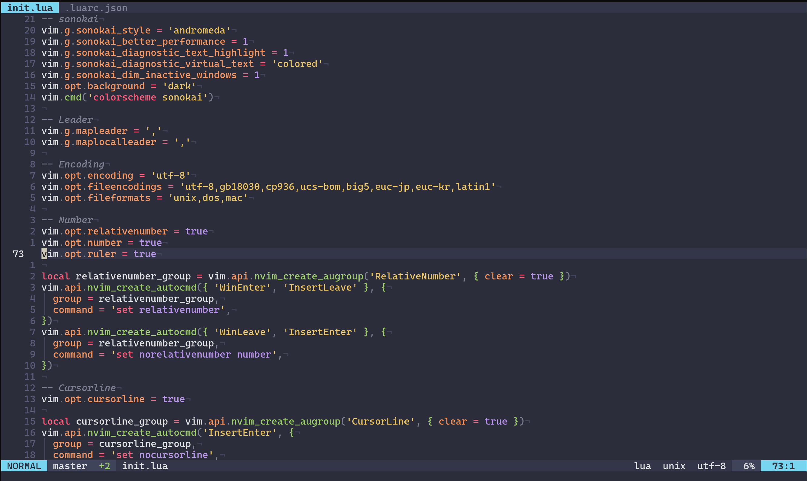

# monkey-nvim

其他语言版本：[English](README.md)

## 简介

monkey-nvim项目，旨在基于 Neovim 打造一个强大、快速的纯终端原生 IDE。

**定位：** monkey-nvim 面向纯终端环境。适用环境：

| 环境       | 说明                                                                               |
| ---------- | ---------------------------------------------------------------------------------- |
| Linux 终端 | xterm, kitty, alacritty, wezterm, gnome-terminal 等                                |
| macOS 终端 | Terminal.app, iTerm2, kitty 等                                                     |
| WSL        | Windows Subsystem for Linux（推荐 WSL2）                                           |
| 服务器 TTY | 原生 Linux 控制台（tty1–tty63），回退到内置 unokai 8/16 色（sonokai 需要 ≥256 色） |
| kmscon     | Kernel Mode Setting 控制台 —— 支持真彩色和 Unicode 的现代 TTY 替代方案             |

多会话/多终端这类顶层工作区管理交给 tmux 或终端模拟器的标签页；编辑器内的分屏和标签页照常使用。

## 截图



## 要求

- Neovim 0.12+（一键安装脚本会在需要时从源码构建当前版本的 Neovim）

## 安装步骤

两种方式任选其一：一键安装脚本，或手动安装。

### 方式一：一键安装

按需构建 Neovim，并自动安装 monkey-nvim 及其全部依赖和插件：

```bash
curl -fsSL https://raw.githubusercontent.com/QMonkey/monkey-nvim/master/install.sh | bash 2>&1 | tee monkey-nvim-install.log
```

> 这条一行命令除了 `curl` 本身还需要 `git`：安装脚本会先把本仓库 clone 到 `~/Documents/monkey-nvim`，然后才能开始安装。全新安装时这个 clone 就是对 `git` 的硬性要求——缺少 `git` 脚本会报错停止，先用系统包管理器装上再重新执行同一条命令即可。（如果那个目录已经是一份 git checkout，脚本只会尝试 `git pull` 它；pull 失败也会继续用这份 checkout 往下装。）

脚本按顺序执行：

1. 预授权一次 `sudo`——整个流程唯一一次密码输入——并为当前用户安装**临时** NOPASSWD sudoers drop-in，脚本退出时自动删除。Homebrew 每次运行都会重置 sudo 时间戳，WSL2 时钟跳变会使票据失效，而 NOPASSWD 让整个流程对两者完全免疫、与命令顺序无关。若 drop-in 装不上，或写入后并未被 sudoers 解析生效，脚本退回依赖 sudo 时间戳：长流程可能还需要一次重新认证，而无法弹出提示的特权步骤会失败并被逐条报告
2. 安装 Neovim 构建依赖（CMake + gettext + tree-sitter parser 编译所需的 C 编译器；构建被固定到 Unix Makefiles 生成器，因此刻意不安装 Ninja——Ninja 下依赖下载卡死既不显示进度也无超时）
3. 安装 Homebrew（Linuxbrew）作为兜底包管理器——即使 brew 已存在，也会把它的 `bin`/`sbin` PATH 插入持久化到 profile 文件（写成幂等的 `case ":$PATH:"` 守卫，而不是 `brew shellenv` 那一行）
4. 克隆并从源码编译 Neovim（已安装 nvim >= 0.12 时跳过），然后 `make install`
5. 克隆 monkey-nvim 到 `~/Documents/monkey-nvim`（已存在则更新）
6. 通过 `checkhealth.sh --install` 安装必需工具 + 可选 LSP server（apt/zypper/dnf/pacman/brew、npm、pip、go install、rustup；Arch 上 AUR（`paru`）这一条通道排在 pacman 与 Homebrew 之间）。脚本会识别 WSL 注入的 Windows 路径 shim（`/mnt/...`），改为安装真正的 Linux 版本；fzf 优先用 Homebrew 以获得新版本而非发行版旧包
7. 在 profile 文件里持久化一个 PATH 块（位置在配置软链之前）：框架 bin 目录（`~/.local/bin`、`${CARGO_HOME:-~/.cargo}/bin`、`GOBIN` 或每个 `GOPATH` 条目的 bin、`~/.npm-global/bin`）加 Homebrew 的 `bin`/`sbin`。两层都是幂等的 PATH 插入，且 Homebrew 那一层在块里先渲染——macOS 上（那里就是普通前置）因此它落在框架 bin 目录之后、`/usr/local/bin` 之前；Linux/WSL 上则按位序插入，只排在 WSL `/mnt` shim 之前，不会前置到系统路径之上（`/usr/local` 本身不会被当作 brew 目录写入）
8. 将 `~/.config/nvim` 软链到仓库，并链接全局 `.clang-format` 风格与 efm-langserver 配置；创建运行时目录（`~/.local/share/nvim/swap`、`~/.local/share/nvim/sessions`）。两个额外配置用 "keep" 模式链接：目标已存在就原样保留，源缺失就静默跳过
9. 以 headless 模式启动 Neovim，通过 vim.pack 自动安装全部插件
10. 写入 `~/.config/env/nvim.env`（0600），本次播种的每个 `NVIM_MINUET_*` 键都在其中——运行前已 export 的值一并写入，其余留空——并在登录 profile 里加一行带 marker 守卫的 `source`（见下文「AI 补全配置」）

> 脚本会把 Neovim 源码保留在 `~/Documents/neovim`（不清理），方便日后 `git pull` + `make` 重新构建。
>
> PATH 修改只对之后新开的 shell 生效。脚本结束时会提示如何让当前终端立即生效（`source <rc 文件>` 或 `exec $SHELL`）。
>
> 有三个路径可以被环境变量覆盖，各自都有默认值：`INSTALL_DIR`（`~/Documents/monkey-nvim`，仓库 clone 到此处，配置软链也从这里发起）、`NVIM_SRC_DIR`（`~/Documents/neovim`，Neovim 源码树）、`NVIM_ENV_FILE`（`~/.config/env/nvim.env`，跟随 `$XDG_CONFIG_HOME`）。`install.sh` 本身不接受任何选项；`checkhealth.sh` 有——见下文「健康检查」。

### 方式二：手动安装

### 1. clone到本地

```bash
git clone https://github.com/QMonkey/monkey-nvim.git
```

### 2. 安装依赖

#### 2.1 通用工具

| 工具                                                          | 用途                                                                               | 是否必须       |
| ------------------------------------------------------------- | ---------------------------------------------------------------------------------- | -------------- |
| git                                                           | 通过 `vim.pack` 管理插件                                                           | 是             |
| [ripgrep (rg)](https://github.com/BurntSushi/ripgrep)         | fzf-lua live grep 后端                                                             | 是             |
| [fzf](https://github.com/junegunn/fzf)                        | fzf-lua 模糊查找后端                                                               | 是             |
| universal-ctags                                               | gutentags 标签生成                                                                 | 是             |
| [GNU Global](https://www.gnu.org/software/global/) (`global`) | gutentags gtags（GTAGS）生成与导航                                                 | 推荐           |
| [Pygments](https://pygments.org/)                             | 非 C/C++ 语言的 gtags 解析器（需要 PATH 上有不带版本号的 `python`）                | 推荐           |
| C 编译器 (gcc/clang)                                          | 编译 tree-sitter parser 原生模块                                                   | 是（仅编译时） |
| [tree-sitter-cli](https://github.com/tree-sitter/tree-sitter) | 编译 tree-sitter parser 模块                                                       | 是（仅编译时） |
| python3                                                       | 写 `nvim.env` 的 `render_fill` 引擎；安装结尾的 TIOCSTI 注入（后者可用 perl 兜底） | 是             |
| [Homebrew](https://brew.sh/)                                  | 系统仓库缺失时的后备包管理器（lua-language-server、marksman、fzf 等）              | 必须           |

```bash
# 安装 Homebrew（所有 Linux 发行版 — 用于安装系统仓库中缺失的工具）
/bin/bash -c "$(curl -fsSL https://raw.githubusercontent.com/Homebrew/install/HEAD/install.sh)"
eval "$(/home/linuxbrew/.linuxbrew/bin/brew shellenv)"

# Ubuntu/Debian
sudo apt-get install git ripgrep fzf universal-ctags global python3-pygments gcc nodejs npm
# tree-sitter-cli 通过 npm 安装：
npm install -g tree-sitter-cli
brew install fzf

# OpenSUSE
sudo zypper install git ripgrep fzf universal-ctags global python3-Pygments gcc nodejs npm
# tree-sitter-cli 通过 npm 安装：
npm install -g tree-sitter-cli

# CentOS（需先启用 EPEL 仓库以获取 ripgrep/fzf/universal-ctags）
sudo dnf install epel-release
sudo dnf install git ripgrep fzf universal-ctags global global-ctags python3-pygments gcc nodejs npm
# Fedora：包名与 CentOS 一致，只是 ctags 在 Fedora 就叫 `ctags`（Fedora 只打包
# Universal Ctags），而且不需要 EPEL——上面那几个包基础仓库里都有。
# tree-sitter-cli 通过 npm 安装：
npm install -g tree-sitter-cli

# Arch Linux
sudo pacman -S git ripgrep fzf ctags global python-pygments gcc nodejs npm
# tree-sitter-cli 通过 npm 安装：
npm install -g tree-sitter-cli

# macOS
brew install git ripgrep fzf universal-ctags global pygments gcc node
# tree-sitter-cli 通过 npm 安装：
npm install -g tree-sitter-cli
```

#### 2.2 LSP 服务器

monkey-nvim 使用 Neovim 内建的 LSP 客户端（`vim.lsp.config`）。请根据需要安装对应语言的服务器：

| 语言       | LSP 服务器                  | 安装方式                                                                                                                                        |
| ---------- | --------------------------- | ----------------------------------------------------------------------------------------------------------------------------------------------- |
| C/C++      | clangd                      | `sudo apt-get install clangd`、`sudo zypper install clang`、`sudo dnf install clang-tools-extra`、`sudo pacman -S clang` 或 `brew install llvm` |
| Go         | gopls                       | `go install golang.org/x/tools/gopls@latest`                                                                                                    |
| Python     | python-lsp-server           | `pip3 install python-lsp-server`                                                                                                                |
| Zig        | zls                         | `brew install zls`（推荐，保持 zig/zls 版本一致）或从 <https://zigtools.org/zls/install/> 下载                                                  |
| Rust       | rust-analyzer               | `rustup component add rust-analyzer`                                                                                                            |
| Lua        | lua-language-server         | `brew install lua-language-server` 或 `sudo pacman -S lua-language-server`                                                                      |
| Shell      | bash-language-server        | `npm install -g bash-language-server`                                                                                                           |
| Vim        | vim-language-server         | `npm install -g vim-language-server`                                                                                                            |
| JavaScript | typescript-language-server  | `npm install -g typescript-language-server typescript`                                                                                          |
| TypeScript | typescript-language-server  | `npm install -g typescript-language-server typescript`                                                                                          |
| JSON       | vscode-json-language-server | `npm install -g vscode-langservers-extracted`                                                                                                   |
| YAML       | yaml-language-server        | `npm install -g yaml-language-server`                                                                                                           |
| Markdown   | marksman                    | `brew install marksman` 或 `sudo pacman -S marksman`                                                                                            |
| Markdown   | efm-langserver              | `go install github.com/mattn/efm-langserver@latest`                                                                                             |

部分 LSP 服务器会把格式化/检查交给**外部工具**，需单独安装。缺失时功能会静默降级（回退到内置诊断或跳过该工具）：

| 语言     | 工具              | 作用                                   | 安装方式                                                                                                                                            |
| -------- | ----------------- | -------------------------------------- | --------------------------------------------------------------------------------------------------------------------------------------------------- |
| C/C++    | clang-tidy        | linter（经 `clangd --clang-tidy`）     | `sudo apt-get install clang-tidy`、`sudo zypper install clang`、`sudo dnf install clang-tools-extra`、`sudo pacman -S clang` 或 `brew install llvm` |
| Go       | staticcheck       | linter（经 `gopls` 的 `staticcheck`）  | `go install honnef.co/go/tools/cmd/staticcheck@latest`                                                                                              |
| Shell    | shfmt             | formatter（经 `bash-language-server`） | `go install mvdan.cc/sh/v3/cmd/shfmt@latest`                                                                                                        |
| Python   | black             | formatter（经 `pylsp` 的 black 插件）  | `pip3 install black python-lsp-black`                                                                                                               |
| Markdown | prettier          | formatter（经 `efm-langserver`）       | `npm install -g prettier`                                                                                                                           |
| Markdown | markdownlint-cli2 | linter（经 `efm-langserver`）          | `npm install -g markdownlint-cli2`                                                                                                                  |

#### 2.3 C/C++

```bash
# Ubuntu/Debian
sudo apt-get install gcc g++ clangd clang-tidy

# OpenSUSE
sudo zypper install gcc gcc-c++ clang

# CentOS
sudo dnf install gcc gcc-c++ clang clang-tools-extra

# Arch Linux
sudo pacman -S gcc clang

# macOS
brew install gcc llvm
```

#### 2.4 Go

```bash
# 请安装最新版本的 go，然后：
go install golang.org/x/tools/gopls@latest
# 可选：staticcheck 检查器（gopls 使用）
go install honnef.co/go/tools/cmd/staticcheck@latest
```

#### 2.5 Python

```bash
# 需要 Python 3（如未安装请先通过系统包管理器安装）
pip3 install python-lsp-server
# 可选：代码格式化与检查工具（pylsp 通过 pylsp-black 插件调用 black，
# 所以插件要和 black 一起装；`lua/lsp.lua` 里 pylint 插件是关掉的，
# 装了也不参与诊断）
pip3 install black python-lsp-black autopep8 flake8 pylint
```

#### 2.6 JavaScript / TypeScript

```bash
npm install -g typescript-language-server typescript
```

#### 2.7 Zig

Zig 的语法高亮、缩进和文件类型检测由 nvim-treesitter 提供，无需安装插件。只需安装 Zig 和 ZLS 语言服务器：

```bash
# 推荐：Homebrew 会保持 zig 与 zls 版本一致
brew install zig zls          # macOS / Linuxbrew

# 或下载版本匹配的预编译二进制：
#   zig: https://ziglang.org/download/
#   zls: https://zigtools.org/zls/install/
```

> **重要：** zls 与特定版本的 Zig 绑定，版本不匹配时会拒绝启动。请从同一来源安装 `zig` 和 `zls`（Homebrew 或官方下载工具）以保持一致。发行版软件包往往滞后：Ubuntu/Debian 稳定版没有 `zig` 包，Arch 的 `zls` 落后于 Arch 的 `zig`，通常不匹配。

保存时格式化由 ZLS 完成（与 `zig fmt` 一致），无需单独安装格式化工具。构建时诊断（`enable_build_on_save`）可在 `build.zig` 旁的 `zls.json` 中开启。

#### 2.8 Rust

```bash
# 安装 rustup（包含 rustc 和 cargo），然后：
rustup component add rust-analyzer
```

#### 2.9 YAML

```bash
npm install -g yaml-language-server
```

#### 2.10 Shell

```bash
# 安装 LSP 服务器，以及它依赖的 shfmt 格式化工具
npm install -g bash-language-server
go install mvdan.cc/sh/v3/cmd/shfmt@latest
```

#### 2.11 Markdown

终端下预览 Markdown：

```bash
# glow（终端 Markdown 渲染器）
# https://github.com/charmbracelet/glow
brew install glow       # macOS / Linuxbrew
sudo pacman -S glow     # Arch Linux
sudo apt-get install glow  # Debian 13+
go install github.com/charmbracelet/glow@latest  # Ubuntu / OpenSUSE / CentOS，或其他已安装 Go 的平台
```

格式化与检查由 [efm-langserver](https://github.com/mattn/efm-langserver) 提供（formatter: prettier，linter: markdownlint-cli2）：

```bash
go install github.com/mattn/efm-langserver@latest
npm install -g prettier markdownlint-cli2
# 将 efm 配置（config.yaml + .markdownlint.jsonc）软链到默认路径
ln -sfn $(pwd)/configs/efm-langserver ~/.config/efm-langserver
```

#### 2.12 字体（可选）

Neovim 使用的 Unicode 字符（⎇, │, ▸, ·, ¬）无需额外字体即可正常显示。如需 Powerline 风格外观，可选择性安装 [Nerd Font](https://github.com/ryanoasis/nerd-fonts)。

### 3. 健康检查

验证所有必需依赖和可选 LSP server 是否就绪：

```bash
./checkhealth.sh
```

加 `--install` 可自动安装缺失的依赖（必需工具 + 可选 LSP 服务器）。支持 apt/zypper/dnf/pacman（Arch 还含 AUR 通道，helper 是 `paru`）/brew、npm、pip、go install 和 rustup：

```bash
./checkhealth.sh --install
```

脚本会识别 WSL 注入的 Windows 路径 shim（`/mnt/...`），改为安装真正的 Linux 版本；`sudo` 仅在确实需要时才会调用（Homebrew 每次运行都会重置 sudo 时间戳，因此可能带着说明文字重新请求一次密码）。

完整选项是 `-i`/`--install`、`--skip-check-config`（跳过配置文件检查——`install.sh` 会带上它，因为配置软链在本脚本之后才建立）和 `-h`/`--help`（打印用法，退出码 0）；无法识别的选项会打印用法并以退出码 2 结束。其余情况下：任一必需依赖缺失退出码为 1，全部就绪为 0。单独跑 `--install` 时只在开头认证一次 `sudo` 并依赖时间戳；`SUDO_DROPIN=1` 才改用临时 NOPASSWD drop-in（`install.sh` 走的就是这条路）。

也可运行 Neovim 内建的健康检查查看插件相关问题：

```bash
nvim --headless -c 'checkhealth' -c 'qa'
```

### 4. AI 补全配置（可选）

minuet-ai.nvim 通过环境变量配置，启动时读取。设置 `NVIM_MINUET_PRESET` 选择
生效的 preset——`local_fim` 或 `openai`；为空或未设置时跳过 minuet 的 setup，
AI 补全整体禁用，其键位也不绑定。每个 preset 只在**它自己的变量全部设置**时才
注册：`lua/ai.lua` 不带任何默认值，配一半等于该 preset 不存在。export 语句加入
登录 shell 配置（zsh 用 `~/.zprofile`，bash 用 `~/.profile` 或 `~/.bash_profile`）：

```bash
# 总开关：local_fim | openai（空/未设置 = 禁用 minuet）
export NVIM_MINUET_PRESET="local_fim"

# 远程 preset（OpenAI 兼容 chat 端点），全部必填
export NVIM_MINUET_API_KEY="..."                            # API key
export NVIM_MINUET_BASE_URL="https://host/provider"         # 前缀，代码会拼接 /v1/chat/completions
export NVIM_MINUET_MODEL="model-id"
export NVIM_MINUET_NAME="DeepSeek"                          # 显示名

# 本地 FIM preset，三项全部必填
export NVIM_MINUET_LOCAL_BASE_URL="http://localhost:8080"   # 前缀，代码会拼接 /v1/completions
export NVIM_MINUET_LOCAL_MODEL="qwen2.5-coder:7b"           # 该服务端认可的模型 id
export NVIM_MINUET_LOCAL_NAME="llama.cpp"                   # 显示名，同时决定请求形态

# 注意：NVIM_MINUET_LOCAL_NAME 决定请求形态。只有 "llama.cpp" 会把请求重写到
# llama.cpp 的 /infill 端点（FIM 正确填充必需）；其他服务——Ollama、vLLM、
# LM Studio——一律走普通的 /v1/completions，所以名字要如实写出服务端是什么。
```

**`~/.config/env/nvim.env` 就是 nvim 自己的环境变量文件，这些变量不必由你手工
写进 profile。** profile 用 `set -a` source 它，所以文件里的东西都会进 nvim 以及
nvim 启动的每个进程的环境——minuet 那套只是安装器当前播种进去的内容。安装前
export 过的话，安装过程会把它们持久化：全部键写入该文件（0600，放在家族共用的
env 文件目录里），各 shell profile 只加一行带 marker 守卫的 source
（路径按 `$NVIM_ENV_FILE` 解析后写死，该值跟随 `$XDG_CONFIG_HOME`）——

```bash
# [normal] nvim env (remove these lines to disable)
[[ -f "$HOME/.config/env/nvim.env" ]] && { set -a; source "$HOME/.config/env/nvim.env"; set +a; }
```

该块的规则（文件与变量名都是 monkey-nvim 自己的，不读写任何其他项目的凭据存储
或变量）：

- `NVIM_MINUET_PRESET` 未设置，或不是 `local_fim` / `openai` → minuet 禁用；
  安装器照样写文件与 profile 行，全部键留空，手工补齐即可，不必重跑安装。
- 播种的八个键都在文件里；本次没 export 的键留空，而空值读作未设置（`nvim.env`
  里导出为空值的变量，到达 `lua/ai.lua` 时是 `nil`）。所以该文件是手工填值的入口，
  而不是一套半配置。
- 你加的其他变量不会被冲掉：`render_fill` 只改写它拿到手的键，其余行原样透传。
- 文件里已有的值优先于本次 export（fill-empty 语义）：重跑安装不会覆盖手工
  编辑，改值直接编辑该文件；重跑也不会重复写块。
- 所选 preset 的变量不齐时，安装器会点出缺哪几个并告警"该 preset 不会注册"——
  文件照写，手工补齐那几行即可，不必重跑安装。
- 该文件由仓库里的 `nvim.env.template` 渲染而来：新建 `nvim.env` 时的注释和键
  清单就是这份模板的内容，而交给渲染器的键集合是 `install.sh` 里的
  `NVIM_ENV_KEYS` 列表（`render_fill` 跑在 python3 上，python3 由依赖安装环节
  作为必需工具装好；python3 缺失时该文件不写，脚本会明确报出来）。
  `nvim.env.template` 必须留在 `install.sh` 旁边：它是安装器的必需输入，
  播种的变量清单要改就是改这份模板。

用法与键位见 §1.14。

### 5. 安装

- Linux、macOS、WSL

```bash
cd monkey-nvim
ln -sfn $(pwd) ~/.config/nvim
ln -sf $(pwd)/configs/.clang-format ~/.clang-format   # 全局 clang-format 风格（可选）
ln -sfn $(pwd)/configs/efm-langserver ~/.config/efm-langserver   # efm：markdown 格式化/检查（可选）
nvim --headless -c 'ZPack sync' -c 'qa'   # 安装所有插件
nvim
```

### 6. 更新

```bash
cd monkey-nvim
git pull
```

然后在 Neovim 中：

```vim
:ZPack update
```

### 7. kmscon 安装与使用（可选）

[kmscon](https://github.com/kmscon/kmscon) 是基于 Linux KMS/DRM 的系统级终端，替代传统的 Linux tty，提供完整的 Unicode 支持、multi-seat 能力和真彩色渲染。它是 monkey-nvim 在无头服务器上的绝佳搭档。

#### 7.1 安装 kmscon

```bash
# Ubuntu/Debian（旧版，不含 terminfo）
sudo apt-get install kmscon

# OpenSUSE（Tumbleweed / Leap 15.x）
sudo zypper install kmscon

# Arch Linux
sudo pacman -S kmscon

# CentOS — 官方与 EPEL 仓库均未提供，改用下方源码编译
# 从源码编译（需要 meson、ninja 和 ncurses 提供的 tic）
git clone https://github.com/kmscon/kmscon.git
cd kmscon
meson setup builddir/
meson install -C builddir/
```

从源码编译时会自动通过 `tic` 编译并安装 kmscon 的 terminfo 条目，nvim 无需任何 `TERM` 变通即可正确检测终端能力。默认安装 prefix 为 `/usr/local`，如需安装到系统路径请在 meson setup 时追加 `--prefix=/usr`。

在较旧的系统上，`libtsm` 等依赖版本可能不满足编译要求。此时使用包管理器版本并通过 7.3 节的 `TERM` 变通方案即可。

#### 7.2 用 kmscon 替代 tty（永久生效）

让 kmscon 取代传统的 tty/getty 成为默认系统控制台：

```bash
# 停止 tty1 上原有的 getty
sudo systemctl stop getty@tty1.service
sudo systemctl disable getty@tty1.service

# 为 tty1 创建 kmscon systemd 服务
sudo mkdir -p /etc/systemd/system/getty.target.wants
sudo ln -s /usr/lib/systemd/system/kmsconvt@.service \
    /etc/systemd/system/getty.target.wants/kmsconvt@tty1.service

# 覆写 ExecStart 使用 kmscon 自带的终端类型
sudo systemctl edit kmsconvt@tty1.service
```

添加以下覆写内容：

```ini
[Service]
ExecStart=
ExecStart=/usr/bin/kmscon "--vt=%I" --seats=seat0 --no-switchvt --login -- /sbin/agetty -o '-p -- \\u' - kmscon
```

最后一个参数 `kmscon` 是 agetty 的 `<termtype>` 位置参数，用于设置 `TERM=kmscon`，与编译时安装的 terminfo 条目匹配。

由于 `kmscon` 这个 terminfo 条目从 **10.0.0** 才开始随源码提供，不同版本的终端类型设置也不同：

```ini
# kmscon 10.0.0+（自带 scripts/terminfo/kmscon.ti，默认 TERM=kmscon）
ExecStart=/usr/bin/kmscon "--vt=%I" --seats=seat0 --no-switchvt --login -- /sbin/agetty -o '-p -- \\u' - kmscon

# kmscon 9.x（没有 kmscon terminfo 条目，改用 xterm-256color）
ExecStart=/usr/bin/kmscon "--vt=%I" --seats=seat0 --no-switchvt --login -- /sbin/agetty -o '-p -- \\u' - xterm-256color
```

如果你的 `agetty` 版本支持 `--noclear` 参数，可以在 `-` 之前加入它，以在登录提示符上保留 kmscon 启动画面；它纯粹是外观选项。

```bash
# 在 tty1 上启动 kmscon
sudo systemctl start kmsconvt@tty1.service
```

重启后，按 `Ctrl+Alt+F1` 即可切换到支持真彩色和 Unicode 的 kmscon 终端。可按需对 tty2–tty6 重复相同操作。

##### `start` 与 `enable` 的区别——常见坑

`systemctl start` 只是运行一次单元，完全不读取 `[Install]` 段，因此不会触碰 `autovt@.service`。`systemctl enable` 会读取 `[Install]` 并创建符号链接，包括 `Alias=autovt@.service`。

tty2–tty6 **并不**由 `getty.target.wants` 启动；systemd-logind 会把每个新激活的 VT 以 `autovt@ttyN.service` 的方式拉起，它通过 `autovt@.service` 这个别名来解析。Debian/Ubuntu 打包的 `kmsconvt@.service` 自带了该别名：

```ini
[Install]
WantedBy=getty.target
DefaultInstance=tty1
Alias=autovt@.service
```

因此：

- `systemctl enable kmsconvt@tty1.service` → 只影响 tty1（实例别名 `autovt@tty1.service`）。
- `systemctl enable kmsconvt@.service`（模板，不带 ttyN）→ **所有 VT**，因为它会创建 `/etc/systemd/system/autovt@.service -> kmsconvt@.service`。

上面的 `ln -s ... kmsconvt@tty1.service` + `start` 流程因此只作用于 tty1。如果发现 tty2–tty6 意外也变成了 kmscon，请检查残留的别名（回退方法见 7.5 节）。

#### 7.3 真彩色支持

kmscon 支持真彩色（24-bit）。monkey-nvim 通过 `has('termguicolors')` 自动检测并使用 GUI 颜色渲染。

如果通过包管理器安装的 kmscon 版本较旧（不含 terminfo）或 terminfo 条目缺失，nvim 会报错 `E558: Terminal entry not found in terminfo`。此时在 shell 配置中添加以下内容即可：

```bash
# 添加到 shell 配置文件中（~/.bashrc、~/.zshrc 等）
export TERM=xterm-256color
export COLORTERM=truecolor
```

`COLORTERM=truecolor` 必须在 `TERM=xterm-256color` 时设置，否则 nvim 无法检测到真彩色支持。注意使用 `xterm-256color` 替代 kmscon 原生 terminfo 可能导致一定的终端刷新异常。如需最佳体验，请从源码（10.0.0+）编译获取原生 terminfo 条目。

如果在 kmscon 中使用 tmux，tmux 会把 `$TERM` 覆盖为 `tmux` / `tmux-256color`。这是正常且正确的行为——**不要**改回去。tmux 会根据外层终端生成自己的内部 `TERM` 并对外暴露准确的能力，nvim 等 ncurses 程序因此能正确工作。只有**外层**（进入 tmux 之前）的 `$TERM` 才重要：10.0.0+ 保持 `kmscon`，9.x 保持 `xterm-256color`。

Linux 原生控制台（tty1–tty63，`TERM=linux`）只提供 8/16 色（`&t_Co < 256`），这会触发 sonokai 的守卫条件（`&t_Co < 256 -> finish`），从而保留内置的 8/16 色高亮，保证代码仍可阅读。sonokai 本身并不要求真彩色——在任何 256 色终端上都能通过 `cterm` 调色板正常渲染——但它在可用颜色少于 256 时会拒绝加载。monkey-nvim 因此在裸 tty 上回退到内置的 `unokai` 主题。如需在物理控制台上获得完整的 sonokai 配色，请用 kmscon 替代 tty（见 7.2 节）或改用任意 256 色/真彩色终端。

如果在裸 tty（非 kmscon）上运行 tmux，tmux 默认 `default-terminal=tmux-256color`，会向其中的所有程序宣称「256 色 + xterm 风格键序列」——即便底层控制台只有 8/16 色。monkey-nvim 已经能识别这种情况（它向上遍历进程树，看到 tmux 客户端背后的真实 tty），并回退到内置高亮，因此 nvim 自身始终正确。但其他程序没有这层保护，可能输出控制台无法显示的 256 色转义序列。要让它们也正确，把 tmux 的终端类型设为与 8 色控制台匹配：

```bash
# 写入 ~/.tmux.conf —— 仅适用于在裸 Linux tty 上运行的 tmux
set -g default-terminal "tmux"
set -g terminal-overrides ",linux:colors=16"
```

第一行让 tmux 向程序宣称普通的 8 色终端；第二行告诉 tmux 底层 `linux` 控制台有 16 色（8 基础色 + 8 亮色），使其能合理降级。**不要**在 kmscon 或普通终端模拟器下运行 tmux 时添加这两行——那些场景 `tmux-256color` 才是正确的。

#### 7.4 字体（可选）

kmscon 使用系统内建的字体渲染器。如需 Powerline 风格图标，安装任意系统等宽字体即可。

#### 7.5 回退到传统 tty/getty

将虚拟控制台交还给 agetty：

```bash
# 停止 kmscon 实例
sudo systemctl stop kmsconvt@tty1.service

# 删除 7.2 节创建的 tty1 wants 链接
sudo rm -f /etc/systemd/system/getty.target.wants/kmsconvt@tty1.service

# 在 tty1 上恢复 getty
sudo systemctl enable getty@tty1.service
sudo systemctl start getty@tty1.service
```

如果之前执行过 `systemctl enable kmsconvt@.service`（模板），`autovt@.service` 别名现在指向 kmscon，会继续替换所有 VT。需要显式回退：

```bash
# 让 autovt@.service 指回 getty（去掉 kmscon 别名）
sudo systemctl disable kmsconvt@.service
sudo rm -f /etc/systemd/system/autovt@.service

# 重新启用 getty（同时恢复 getty@tty1.service）
sudo systemctl enable getty@.service

# 重新加载，让 logind 对新激活的 VT 生效
sudo systemctl daemon-reload
```

验证别名已指回 getty：

```bash
readlink -f /etc/systemd/system/autovt@.service /usr/lib/systemd/system/autovt@.service
```

应解析到 `getty@.service`。

## `scripts/`（共享框架）

`scripts/` 目录是 [monkey-scripts](https://github.com/QMonkey/monkey-scripts) 的
[git subtree](https://git-scm.com/docs/git-subtree) —— 本仓库 `install.sh` 与
`checkhealth.sh` 所依赖的共享安装/检查框架。请勿在此目录内直接修改，更新应来自上游：

```bash
# 首次拉取（克隆时未带 subtree）：
git subtree add -P scripts https://github.com/QMonkey/monkey-scripts.git master
# 后续更新：
git subtree pull -P scripts --squash https://github.com/QMonkey/monkey-scripts.git master
```

一键安装无需 subtree：`curl | bash` 路径会把**本仓库** clone 到安装目录
（`~/Documents/monkey-nvim`）并运行其中的 `install.sh`，因此安装脚本与它加载
的 `scripts/` 必定来自同一版本。如果该目录已存在但不是 git clone，安装程序会
拒绝改动它并如实告知。上面的 subtree 提交并推送后，正常 `git clone` 本仓库即已
包含 `scripts/` —— 无需再单独 clone 或 pull monkey-scripts，更新只需 `git pull`
本仓库。只有早于该提交的旧 checkout 缺少 `scripts/`：`git pull`（或重新运行
`install.sh`，它会在该 checkout 上直接 pull）即可修复。

## 插件列表

| 插件                                                                                                          | 用途                                         |
| ------------------------------------------------------------------------------------------------------------- | -------------------------------------------- |
| [zuqini/zpack.nvim](https://github.com/zuqini/zpack.nvim)                                                     | 基于内置 `vim.pack` 的懒加载插件管理器       |
| [sainnhe/sonokai](https://github.com/sainnhe/sonokai)                                                         | 配色方案                                     |
| [nvim-lualine/lualine.nvim](https://github.com/nvim-lualine/lualine.nvim)                                     | 状态栏                                       |
| [nvim-mini/mini.extra](https://github.com/nvim-mini/mini.extra)                                               | mini.nvim 扩展模块（ai 规格）                |
| [nvim-mini/mini.ai](https://github.com/nvim-mini/mini.ai)                                                     | 文本对象                                     |
| [nvim-mini/mini.surround](https://github.com/nvim-mini/mini.surround)                                         | 围绕字符编辑                                 |
| [nvim-mini/mini.comment](https://github.com/nvim-mini/mini.comment)                                           | 注释切换                                     |
| [andymass/vim-matchup](https://github.com/andymass/vim-matchup)                                               | 扩展 % 跳转配对                              |
| [windwp/nvim-autopairs](https://github.com/windwp/nvim-autopairs)                                             | 自动配对括号                                 |
| [gbprod/substitute.nvim](https://github.com/gbprod/substitute.nvim)                                           | 使用剪贴板替换                               |
| [chentoast/marks.nvim](https://github.com/chentoast/marks.nvim)                                               | 可视化书签                                   |
| [ibhagwan/fzf-lua](https://github.com/ibhagwan/fzf-lua)                                                       | 模糊文件/缓冲/tag 查找                       |
| [folke/flash.nvim](https://github.com/folke/flash.nvim)                                                       | 快速跳转                                     |
| [kevinhwang91/nvim-ufo](https://github.com/kevinhwang91/nvim-ufo)                                             | 折叠                                         |
| [kevinhwang91/promise-async](https://github.com/kevinhwang91/promise-async)                                   | 异步库（ufo 依赖）                           |
| [nvim-treesitter/nvim-treesitter](https://github.com/nvim-treesitter/nvim-treesitter)                         | 语法高亮与解析                               |
| [nvim-treesitter/nvim-treesitter-context](https://github.com/nvim-treesitter/nvim-treesitter-context)         | 窗口顶部常驻的上下文行                       |
| [nvim-treesitter/nvim-treesitter-textobjects](https://github.com/nvim-treesitter/nvim-treesitter-textobjects) | treesitter 文本对象、跳转与交换              |
| [saghen/blink.cmp](https://github.com/saghen/blink.cmp)                                                       | 补全引擎（LSP/缓冲区/路径/命令行/片段一体）  |
| [saghen/blink.lib](https://github.com/saghen/blink.lib)                                                       | 共享库（blink.cmp 依赖）                     |
| [rafamadriz/friendly-snippets](https://github.com/rafamadriz/friendly-snippets)                               | 常用代码片段集合                             |
| [lewis6991/gitsigns.nvim](https://github.com/lewis6991/gitsigns.nvim)                                         | Git 差异标记                                 |
| [nvim-mini/mini-git](https://github.com/nvim-mini/mini-git)                                                   | Git 集成（`:Git` 透传 + 事件）               |
| [stevearc/oil.nvim](https://github.com/stevearc/oil.nvim)                                                     | 文件管理器（替代 netrw）                     |
| [ludovicchabant/vim-gutentags](https://github.com/ludovicchabant/vim-gutentags)                               | 自动生成 ctags                               |
| [dhananjaylatkar/cscope_maps.nvim](https://github.com/dhananjaylatkar/cscope_maps.nvim)                       | Cscope 集成                                  |
| [kevinhwang91/nvim-bqf](https://github.com/kevinhwang91/nvim-bqf)                                             | Better quickfix 窗口（预览、过滤、fzf）      |
| [junegunn/fzf](https://github.com/junegunn/fzf)                                                               | fzf 运行时文件（nvim-bqf 依赖）              |
| [jake-stewart/multicursor.nvim](https://github.com/jake-stewart/multicursor.nvim)                             | 多光标编辑                                   |
| [milanglacier/minuet-ai.nvim](https://github.com/milanglacier/minuet-ai.nvim)                                 | AI 内联补全（virtual text，远程 + 本地 FIM） |

### 插件版本（lockfile）

上面每个插件的版本都由仓库根目录的 `nvim-pack-lock.json` 钉住。它是 Neovim 自带
`vim.pack` 的 lockfile，不是 monkey-nvim 的产物：路径取自 `'packlockfile'`，默认
值 `$XDG_CONFIG_HOME/nvim/nvim-pack-lock.json`，而 `~/.config/nvim` 是指向本仓库
的软链（见 `install.sh` 的 `INSTALL_DIR` → `~/.config/nvim`），所以文件就落在
这里。Neovim 在安装脚本的 headless 首启、以及每次 `:ZPack update`/`:ZPack sync`
时写它，并在下次启动的第一次 `vim.pack` 调用时读它——lockfile 在场时，其中每个
插件都会一次性按记录的 revision 安装，而不再按 `version` 推断分支头。
`:ZPack restore` 就是按 lockfile 回滚（`vim.pack.update({target = 'lockfile'})`）。

不要手工编辑它：已安装插件的损坏条目由 `vim.pack` 自行修复。请把它提交进版本
库——换一台机器、另一个 OS 才能复现同一套插件版本，而
`git diff -- nvim-pack-lock.json` 就是一次更新真正动了什么的可见清单。每次实际
生效的更新也都会记进 `log` 标准路径下的 `nvim-pack.log`（`:echo stdpath('log')`）。

## 快捷键

```text
以下所有"Leader"键，都代表","键
```

### 1. 正常模式

#### 1.1 按键修改

```text
x       用剪贴板的内容替换文本对象选中的字符串（详见§1.6）
X       用剪贴板的内容替换当前光标到行尾的文本（详见§1.6）
Y       复制到行尾，相当于"y$"命令
H       跳到当前行第一个非空字符,相当于"^"命令
L       跳到当前行最后一个字符,相当于"$"命令
U       Redo，相当于"Ctrl-r"
;       进入命令行模式，相当于":"键
q       退出窗口（含 diff/git/quickfix 特殊处理）
Shift+q  退出vim，相当于命令":qa"
t       记录操作，相当于原来的q（普通模式和可视化模式）

j       移至下一显示行（gj），在折行中正常移动
k       移至上一显示行（gk），在折行中正常移动
f       搜索 1 个字符跳转（flash.nvim 带提示）
F       搜索字符并聚焦到匹配末尾（flash.nvim）
```

以下按键在插入模式和命令行模式下均适用：

```text
Ctrl+p  上移        (Up)
Ctrl+n  下移        (Down)
Ctrl+b  左移        (Left)
Ctrl+f  右移        (Right)
Ctrl+a  跳到行首    (Home)
Ctrl+e  跳到行尾    (End)
Ctrl+h  退格        (BackSpace)
Ctrl+d  向前删除    (Del)
```

#### 1.2 F1 ~ F5

```text
F1      打开 fzf-lua live grep
F2      切换 fzf-lua 恢复/关闭
F3      在底部新终端中运行命令（预填 :botright 20new | terminal，输入命令后回车；直接回车打开空终端）
F4      切换全局终端（底部，打开/隐藏）
F5      切换全局终端（右侧，打开/隐藏）
```

使用 `<Ctrl-\><Ctrl-n>` 从终端模式切换到普通模式；终端窗口里的滚轮同样是在终端模式下映射的，`<ScrollWheelUp>`/`<ScrollWheelDown>` 先退出终端模式再滚动缓冲区。

#### 1.3 缓冲

```text
Leader+o    输入打开文件的路径，并在当前窗口打开一个缓冲
[+b         切换到上一个缓冲
]+b         切换到下一个缓冲
```

#### 1.4 分屏

```text
Leader+Leader+s    输入打开文件的路径，并创建一个水平分屏的窗口
Leader+Leader+v    输入打开文件的路径，并创建一个垂直分屏的窗口

Alt+h      跳转到左窗口（普通/插入/终端模式）
Alt+j      跳转到下窗口（普通/插入/终端模式）
Alt+k      跳转到上窗口（普通/插入/终端模式）
Alt+l      跳转到右窗口（普通/插入/终端模式）
Ctrl+h     跳转到左窗口（普通模式别名）
Ctrl+j     跳转到下窗口（普通模式别名）
Ctrl+k     跳转到上窗口（普通模式别名）
Ctrl+l     跳转到右窗口（普通模式别名）
Leader+z   窗口放大/恢复
```

#### 1.5 Tab

```text
Leader+Leader+t      输入打开的文件路径，并创建一个新tab窗口

[+t         切换到上一个tab窗口
]+t         切换到下一个tab窗口
Leader+1~9  切换到第1~9个tab窗口
Leader+[    切换到第一个tab窗口
Leader+]    切换到最后一个tab窗口
```

#### 1.6 替换（substitute.nvim）

```text
x{文本对象}  用剪贴板内容替换一个文本对象（如 xiw 替换当前词）
xx          用剪贴板内容替换当前整行
X           用剪贴板内容替换从光标到行尾
```

#### 1.7 LSP（Language Server Protocol）

```text
K (gh)             查看光标所在符号的文档说明（LSP 文件类型）
K                   其他文件类型使用 `:Man`，Vim/help 文件使用 `:help`
```

`K` 走的是文件类型的 `keywordprg`，由 `lua/docset.lua` 设置：LSP 文件类型指向
`:LspHover`（包装 `vim.lsp.buf.hover()` 的自定义命令），C 指向 `:Man` 并带自定的
`MANSECT` 顺序（这样 clangd 不会把 `K` 抢走），Vim/help 缓冲用 `:help!`。
`gh` 是 LSP 悬浮映射，只要挂上了 LSP 就能用，C 也包括在内。

```text
gd                 跳转到定义（无 LSP 时回退到标签跳转）
gc                 跳转到声明
gt                 跳转到类型定义
gi                 跳转到实现（结果在 quickfix 中）
gr                 查看引用（结果在 quickfix 中）

Leader+rn          重命名符号
[d                 上一个诊断
]d                 下一个诊断
[D                 第一个诊断
]D                 最后一个诊断
Leader+d           切换 location list（当前 buffer 诊断）
```

文件在保存时自动通过 LSP 格式化。自动补全默认开启 — LSP 建议会自动弹出。

#### 1.8 文件/缓冲/Tag 导航（fzf-lua）

```text
Ctrl+p      搜索文件

Leader+b    搜索缓冲
Leader+t    搜索当前文件Tag
Leader+p    搜索项目Tag
Leader+f    搜索当前文件函数
Leader+e    搜索当前文件行
Leader+a    当前目录搜索光标所在的词
```

#### 1.9 折叠（nvim-ufo）

```text
za      当光标下的折叠打开时，关闭它。当折叠关闭时，打开它
zc      关闭光标下的折叠
zo      打开光标下的折叠
zR      打开所有折叠
zM      关闭所有折叠
```

上面都是 Vim 原生折叠命令——`lua/navigation.lua` 只配置 ufo 的 provider 与折叠摘要文字，没有绑定任何折叠键。`lua/editor.lua` 在 `VimEnter` 之前设置 `foldcolumn='0'`、`foldlevel=99`、`foldlevelstart=99`，因此恢复 session 后默认全部展开。ufo 本身按 spec 里的 `event = 'VeryLazy'` 懒加载，另外提供 `:UfoEnable`/`:UfoDisable`/`:UfoInspect`/`:UfoAttach`/`:UfoDetach` 等命令。

#### 1.10 Marks（marks.nvim）

```text
m[a-zA-Z]   设置标记
m,          添加下一个可用的标记
m;          开关当前行上下一个可用的标记

dm[a-zA-Z]  删除标记[a-zA-Z]
dm-         删除当前行的所有标记
dm<Space>   删除当前buffer的所有标记

'[a-zA-Z]   跳转到标记[a-zA-Z]
m] / m[     跳转到下一个 / 上一个标记
m} / m{     跳转到同组书签的下一个 / 上一个（跨 buffer）
m:          预览标记（回车则预览下一个标记）
m[0-9] / dm[0-9]   添加 / 删除第 [0-9] 组的书签
dm=         删除光标所在的书签

:MarksListBuf / :MarksListAll / :MarksListGlobal
            把当前 buffer / 所有打开 buffer / 所有全局标记填入 Location List
```

#### 1.11 Oil（文件管理器，替代netrw）

```text
-           在当前窗口打开文件所在的文件夹
~           在当前窗口打开项目根路径或用户主目录

<CR>        进入目录或打开文件
-           返回上一级目录
```

#### 1.12 终端

```text
F3      在底部新终端中运行命令（预填 :botright 20new | terminal，输入命令后回车；直接回车打开空终端）
F4      切换全局终端（底部，20 行）
F5      切换全局终端（右侧，半宽）
```

F4/F5 切换同一个全局终端——可见时按任意键隐藏，隐藏后在当前 tab 重开（job 与滚动历史保留）。F3 每次打开一个额外终端，命令作为 job 运行，结束后窗口保留并显示 `[Process exited N]`。

使用 `<Ctrl-\><Ctrl-n>` 从终端模式切换到普通模式。`Alt+;` 是更顺手的选择，且适用于所有模式（normal 模式下是 no-op，其他模式等价于 Esc）；`Ctrl+[` 不可用：它就是 Esc 字节，映射它会夺走终端内程序的 Esc。相关修复：`r` 后跟特殊键（如 `Alt+;`）会像 `Esc` 一样中止，而不是把该键当作替换字符插入（对 multicursor.nvim 多光标会话同样生效）。`Alt+h/j/k/l` 可以在终端模式下直接切换分屏；焦点回到终端窗口时自动恢复终端模式。终端窗口里的滚轮是在终端模式下映射的：`<ScrollWheelUp>`/`<ScrollWheelDown>` 先发 `<C-\><C-n>` 退出终端模式，再滚动，因此滚的是缓冲区，而不是让里面的程序收到鼠标转义序列。终端窗口不显示行号和空白标记。

#### 1.13 发送到 pane（,s 组）

文本发送到 tmux pane；不在 tmux 时发送到 F4/F5 全局终端（首次发送自动以右侧
vsplit 打开）。首次发送会弹出 fzf 选择 pane 并自动挂载（随 shada 按项目持久
化），之后的发送直达挂载目标。挂载项在 picker 中以 `*` 标记，nvim 自身的
pane 不在列表中；目标消失或被替换（如 tmux 重启后复用 pane id，通过 pane 上
存储的 uuid 校验身份）时自动摘除。

```text
,ss     将可视选区/当前行粘贴到 tmux pane（fzf-lua 选择）
,sf     粘贴当前文件路径
,sp     输入提示词并粘贴
,sm     在目标 pane 中回车提交
,sa     挂载一个 pane（发送不再弹选择器）
,sd     取消挂载
```

,ss、,sf、,sp 只粘贴不提交，方便在目标里继续组织内容；,sm 回车提交。

#### 1.14 Minuet（AI 代码补全）

内联 AI 建议（virtual text），通过环境变量配置两个 preset：远程 OpenAI 兼容 chat
端点和本地 FIM 服务（Ollama、llama.cpp、vLLM、LM Studio 等）。生效的 preset 在
启动时由 `NVIM_MINUET_PRESET` 决定（见安装步骤 §4）；之后可用 `,ia` 或
`:Minuet change_preset openai|local_fim` 切换。若 `NVIM_MINUET_PRESET` 为空或
未设置，minuet 不会初始化，下面的键位都不会绑定；没有注册的 preset 也切不过去，
`,ia` 只在已注册的 preset 之间循环。自动触发除 `help`、`markdown`、`text`、
`gitcommit`、`gitrebase`、`qf`、`TelescopePrompt`、`DressingInput` 和
`terminal` 之外的所有文件类型都会触发。

普通模式：

```text
,ig     开关补全自动触发
,ia     切换 AI provider preset（本地 <-> 远程）
```

插入模式（有建议显示时）：

```text
<A-a>   接受整条建议
<A-e>   只接受一行
<A-y>   接受 n 行（会提示输入行数）
<A-n>   下一条建议
<A-p>   上一条建议
<A-d>   取消显示
```

#### 1.15 围绕字符编辑（mini.surround）

```text
sa+textobj+surroundA        在textobj指定的范围增A围绕字符
sd+surroundA                删除A围绕字符（2sd" 删除第2层嵌套）
sr+surroundA+surroundB      将A围绕字符改成B围绕字符
sf / sF                     向右 / 向左查找围绕字符（光标移过去）
sh                          高亮光标所在的围绕字符
```

单独的 `s` 在 normal 和 visual 模式都被映射成 `<Nop>`（`lua/editor.lua`）：mini.surround
只绑定 `sa`/`sd`/`sf`/`sF`/`sh`/`sr`，并没有单独的 `s`，否则超时的 `s` 会落回 Vim 原生的
substitute（`cl`），把光标下的字符删掉。

#### 1.16 操作符（Operators）

操作符与文本对象（§1.17）或 motion 组合使用：`{操作符}{文本对象}`。以下操作符均支持 `[count]`。

```text
# Vim 原生
d c y           删除 / 修改 / 复制
gu gU g~        转小写 / 转大写 / 大小写互换
> <             缩进调整
=               按缩进规则重排
!               通过外部命令过滤行
gn gN           操作下一个 / 上一个搜索匹配
gc              注释开关（mini.comment）

# substitute.nvim（见 §1.6）
x               用寄存器内容替换文本对象 / motion
xx              替换当前整行
X               替换光标到行尾

# mini.surround（见 §1.15）
sa{motion}{char}    增加围绕字符（2saiw 会使围绕字符翻倍）
sd{char}            删除围绕字符    [count] = 嵌套层级，如 2sd"
sr{old}{new}        替换围绕字符    [count] = 嵌套层级
```

#### 1.17 文本对象（mini.ai / nvim-treesitter-textobjects / vim-matchup / flash.nvim）

所有文本对象都能配合任意操作符（§1.16）使用。mini.ai 接管了 operator-pending 和 visual 模式的 `a` / `i` 前缀，等待一个标识符字符；未识别的标识符回落到原生行为。连续输入（如 visual 模式下按两次 `a(`）可逐层扩展选区。下面 nvim-treesitter-textobjects 的那几对是完整的 `a`/`i`+标识符映射，因此在同样的键上优先于 mini.ai 的前缀（`af`/`if`、`ac`/`ic`、`aL`/`iL` 等）。

```text
# Vim 原生（未识别的标识符自动回落）
iw aw iW aW     词 / 字串
is as ip ap     句子 / 段落
i( a( i[ a[ i{ a{ i< a<   括号
i" a" i' a' i` a`   引号
it / at         HTML/XML 标签
gn / gN         上次搜索匹配

# mini.ai（增强搜索；默认规格 + lua/editor.lua 里追加的自定义规格）
( ) [ ] { } < >     平衡括号（开闭两种形式）
b               自动检测 ) ] }
" ' `           平衡引号
q               自动检测 " ' `
t               标签（平衡匹配）
f               函数调用（模式匹配，不是 treesitter）
a               参数（模式匹配：在 ) ] } 内以 `,` 分隔）
i               缩进块：`ii` 内部 / `ai` 范围（如 dii、dai、yii）
e               行：`ie` 去缩进 / `ae` 整行（2ae 跨两行）
B               缓冲区：`aB` 全部行 / `iB` 去掉首尾空行
?               交互输入（输入两个分隔符字符）

# nvim-treesitter-textobjects（lua/treesitter.lua）
af / if         函数外部 / 内部       （visual + operator-pending）
ac / ic         类外部 / 内部
aP / iP         参数外部 / 内部
aL / iL         循环外部 / 内部
ad / id         条件外部 / 内部
aC / iC         注释外部 / 内部
]f / [f         下一个 / 上一个函数起始处        ]F / [F   …函数结尾
]c / [c         下一个 / 上一个类起始处          ]C / [C   …类结尾
]P / [P         下一个 / 上一个参数起始处        ]L / [L   …循环起始处
                （跳转类：normal、visual、operator-pending 都可用）
Leader+x        把光标所在参数与下一个交换
Leader+X        与上一个交换

# nvim-treesitter-context（lua/treesitter.lua）
[o              光标移入顶部常驻的上下文行

# vim-matchup（关键词块）
i% / a%         if...endif、function...endfunction 等的内部 / 范围
2i%             第 2 层包围块的内部

# flash.nvim（treesitter 选区）
F               visual 模式：选区扩展到外层 treesitter 节点
                operator-pending 模式：对光标下的 treesitter 节点执行操作
```

各插件的 `[count]` 语义：

```text
Vim 原生        重复对象本身（2iw = 两个词）；括号类无嵌套 count
mini.ai         括号 / 引号 / 标签：count = 嵌套层级（2a( 选外一层）
                visual 模式下连续输入同样向外扩展
vim-matchup     count = 第 N 层包围块
```

自定义标识符（`i` / `e` / `B`）与 Neovim 0.13 的说明：

- 小写 `l` 不能用作标识符：mini.ai 默认的 `al` / `il` 扩展映射
  （around/inside-last，即"上一个匹配对象"）会遮蔽它。这是上游的刻意行为：
  Neovim 0.13 新增了原生 `il`/`al`，mini.ai 为向后兼容继续遮蔽。大写 `L` 同样
  已被占用——`aL`/`iL` 是上面那组 treesitter 循环文本对象——所以行对象注册在
  `e` 上（`lua/editor.lua`）。
- 0.13 原生 `il`（"inner line"）去除首部**和尾部**空白，且在空白行上直接失败；
  我们的 `ie` 只去缩进、保留尾部空白。
- 0.13 原生 `al` 是 "all lines"（整个 buffer，linewise）；我们的 `ae` 是当前行
  （charwise），整个 buffer 是 `aB`。副作用：原生 `{}` 块别名 `aB` 被遮蔽，
  请改用 `a{` / `a}`。
- mini.ai 其余的扩展映射保持上游默认：`an`/`in`（around/inside-next）是刻意覆盖
  Neovim 0.12+ 内建的增量选区 `an`/`in`。而它"跳到 `a` 文本对象边缘"的
  `g[`/`g]` 这一对在本配置里被关掉（`lua/editor.lua`），`g]` 因此仍是
  _常用命令 §4_ 里那个 ctags 处理键。

#### 1.18 其他

```text
Leader+ws       保存当前项目的session
Leader+rs       删除session（需确认）

'.              最后一次变更的地方
''              跳回来的地方（最近两个位置跳转）
Ctrl+o          跳回，可用于多种类型跳转
Ctrl+i          继续上次跳转（与Ctrl+o操作相反）
cod             切换diff模式
cop             切换paste模式
col             切换list模式
con             清除搜索高亮
Leader+cr       切换到当前文件所在项目根路径
Leader+space        去除行尾空白字符
Leader+Leader+space  去除行尾空白字符 + \r（DOS 换行符）
Leader+q            打开/关闭quickfix（bqf 预览）
Leader+l            打开/关闭location list
Leader+gg           Git status 面板（fzf-lua：stage/unstage/reset，diff 预览）
Leader+gc           当前文件的 Git commits（可视模式：选中行历史）
Leader+gC           仓库的 Git commits
Leader+gl           当前文件 Git log（mini.git，tab 打开）
Leader+gL           所有分支的 Git log（带 graph，tab 打开）
Leader+gS           光标处历史：行/选区 git log -L，或展开光标所在 commit 的 diff
Leader+gF           打开光标所在 commit 时的文件（用于 log/diff 内下钻）
Leader+gd           Gitsigns diff this（当前文件并排 diff）
Leader+gD           Git diff 工作区全部改动（tab 打开）
Leader+gb           Gitsigns blame line
Leader+gB           Gitsigns blame
Leader+hs           Gitsigns stage hunk
Leader+hS           Gitsigns stage buffer
Leader+hr           Gitsigns reset hunk
Leader+hR           Gitsigns reset buffer
Leader+hp           Gitsigns preview hunk inline
Leader+hP           Gitsigns preview hunk
Leader+hq           Gitsigns set quickfix
Leader+hQ           Gitsigns set quickfix all
Leader+hl           Gitsigns set loclist

可视模式：
Leader+gS           对选中行执行 `git log -L`
Leader+gc           对选中行执行 Git commits 历史

fzf-lua picker 内（预览滚动）：
A-u / A-d           半屏上/下滚动
A-j / A-k           行下/上滚动
S-down / S-up       全屏下/上滚动（fzf-lua 默认）
F3                  切换预览自动换行（默认开启）
Git status：ctrl-h / ctrl-l = stage / unstage
`A-f` / `A-i` / `A-h` 刻意不占用：fzf-lua 把它们留给自己的文件动作
（toggle-follow / ignore / hidden）。

多光标（multicursor.nvim）：
Ctrl+n              在下一个匹配处增加光标——也是从 normal/visual 开启
                    多光标会话的按键
会话期间（插件的 keymap layer 接管以下按键）：
Ctrl+n / Ctrl+p     在下一个 / 上一个匹配处增加光标
Ctrl+x / Ctrl+q     跳过当前匹配 / 取消跳过上一个
Esc 或 Alt+;        清除全部额外光标；已禁用时则重新启用

SudoWrite           使用 root 权限保存文件
```

在 quickfix/location 窗口中：

- `o`/`Enter` — 打开条目（文件+行号）
- `q` — 关闭窗口
- nvim-bqf：浮窗实时预览（treesitter 高亮），`<Tab>`/`<S-Tab>` 标记条目后 `zn`/`zN` 过滤成新列表，`zf` 进入 fzf 过滤，`<C-t>`/`T` 在新 tab 打开

`gdefault` 已设置，`:s` 默认执行全局替换。`jumpoptions+=stack` 使跳转列表行为类似标签栈。

Viminfo 的对应物 shada 按工程隔离：命令/搜索历史、寄存器和 file marks 保存到 `~/.local/state/nvim/shada/<工程根目录扁平化>.shada`（从启动目录向上查找 `.git`/`.root`/`.hg`/... 标记定位工程根，找不到时回退到 `~`），各工程的历史互不干扰。与 Vim 的 viminfo 不同，Neovim 的 shada 不持久化跳转列表。

#### 1.19 自动插入文件头

新建 `.sh` 和 `.py` 文件会自动插入 shebang 行：

- `.sh` → `#!/usr/bin/env bash`
- `.py` → `#!/usr/bin/env python3`

### 2. 插入模式

#### 2.1 代码片段（blink.cmp）

```text
Ctrl+l      展开/确认补全
Tab         跳转到下一个占位符
Shift+Tab   跳转到上一个占位符
```

补全快捷键：

```text
Ctrl+l      确认补全或展开/跳转代码片段
Ctrl+j      选择下一个补全项
Ctrl+k      选择上一个补全项
CR          确认补全（选择当前选中项）
```

### 3. 可视化模式

#### 3.1 按键修改

```text
x       用剪贴板的内容替换选中文本（单独 `s` 被映射成 <Nop>，见 §1.15）
;       进入命令行模式，相当于":"键
<       减少缩进，保持选中
>       增加缩进，保持选中
```

#### 3.2 查找

```text
Leader+a        当前目录搜索选中字符串（fzf-lua）
```

#### 3.3 替换

```text
x{文本对象}  用剪贴板内容替换文本对象（如 xiw）
xx          用剪贴板内容替换当前整行
X           用剪贴板内容替换光标到行尾
```

#### 3.4 快速跳转（flash.nvim）

```text
f           搜索1个字符并跳转（flash.nvim）
F           基于 treesitter 的选区（visual 扩展选区 / operator-pending 选中节点）
```

#### 3.5 围绕字符编辑（mini.surround）

```text
sa+surroundA     选中字符串增加A围绕字符（2sa 使围绕字符翻倍）
```

### 4. 命令行模式

```text
Ctrl+p  上一条命令
Ctrl+n  下一条命令
Ctrl+a  跳到命令行最前
Ctrl+e  跳到命令行最后
```

## 常用命令

### 1. SudoWrite

```vim
" 使用 root 权限保存文件
:SudoWrite
```

### 2. fzf-lua

```vim
" 搜索文件
:FzfLua files

" 搜索缓冲区
:FzfLua buffers

" 实时搜索
:FzfLua live_grep

" 搜索 help 标签
:FzfLua help_tags

" 恢复上次搜索
:FzfLua resume
```

### 3. mini.git

```vim
" 在分屏中打开 Git status
:Git status

" 当前文件 Git log
:vert Git log --oneline --follow -- %
```

`:G` 是 `:Git` 的薄封装（`lua/git.lua`）：转发 modifier、`!` 与参数，并把
`<Tab>` 补全交给 `:Git`，所以 `:G log --<Tab>` 的补全与 `:Git log --<Tab>` 一致。

### 4. Gutentags

```vim
" 为当前文件生成ctag
:GutentagsUpdate

" 为整个工程生成ctag
:GutentagsUpdate!

" 强制全量重建当前工程的 gtags + ctags
:TagsRebuild
```

如果安装了 GNU Global（`gtags`/`global`）和 Pygments（`pygmentize`），GTAGS/GRTAGS/GPATH 数据库会在 ctags 之外一并生成——首次 `BufEnter` 时缺就自动全量构建，保存时增量更新，分支/HEAD 身份变化时全量重建（也可用 `:TagsRebuild` 手动触发）。gtags 数据库放在 `~/.local/share/nvim/tags/<工程根目录扁平化>/`，不在工程目录里。

Cscope 快捷键——由 `lua/tags.lua` 绑到 cscope_maps.nvim 的命令上，插件自己的
默认映射是关掉的（`disable_maps = true`、`cscope.tag.keymap = false`）：

```text
gs      查找光标下的符号（Cscope find s）
gD      跳转到定义（Cstag）
gR      查找调用者（Cscope find c）
g]      跳转到标签并打开 quickfix（lua/tags.lua 自己的 ctags 处理，不是 cscope）
```

### 5. Session（原生 :mksession）

```vim
" 保存当前项目的 session 到 ~/.local/share/nvim/sessions/
Leader+ws

" 删除当前 session 文件（弹出确认）
Leader+rs
```

退出 Neovim 时会自动重写已追踪的 session（`v:this_session` 已设置），启动时从
`~/.local/share/nvim/sessions/` 自动恢复——但只在 Neovim 未带文件参数启动时
（`argc() == 0`）；`nvim somefile` 打开的是那个文件，而不是保存的布局。session
文件名是 `<工程根目录扁平化>-session.vim`。每次写入前会清理显示 oil/terminal
等排除类型 buffer 的窗口，它们不会进入保存的 session；写入的文件里也会剔除
指向已不存在目录的 `cd`/`lcd` 行。

## 在 Neovim 中使用 git

### 1. Git 集成：[mini.git](https://github.com/nvim-mini/mini-git)

`:Git` 以异步方式在当前仓库运行任意真实 git 子命令，支持 `<Tab>` 补全子命令、
选项与路径。需要交互编辑器的命令（`git commit`、`git rebase -i` 等）会在
当前会话内打开编辑窗口。

```vim
:Git status
:Git log --oneline --graph --all
:Git pull
:Git push
:Git commit
:Git branch
```

每条命令执行后都会触发 `User` 事件：`MiniGitCommandDone`（`args.data` 中含
`exit_code`、`stdout`、`stderr`、`git_subcommand`）、`MiniGitCommandSplit`，
仓库跟踪数据变化时触发 `MiniGitUpdated`。`MiniGit.show_at_cursor()` 可查看
行/选区历史，或展开光标所在的 commit。

### 2. Git 差异标记：[gitsigns.nvim](https://github.com/lewis6991/gitsigns.nvim)

```vim
]h / [h  跳转到下一个/上一个修改块

:Gitsigns preview_hunk
:Gitsigns stage_hunk
:Gitsigns reset_hunk

:Gitsigns setqflist
:Gitsigns setloclist
```

### 3. 差异查看：mini.git + gitsigns.nvim

```vim
" 工作区全部改动的统一 diff
:vert Git diff

" 当前文件并排 diff（gitsigns，vim diff 分屏）
:Gitsigns diffthis

" 行/选区历史（git log -L）；在 log 分屏中光标停在 commit hash 上可展开该 commit
:lua MiniGit.show_at_cursor()
```

## 注意事项

- **WSL2：在 `/etc/wsl.conf` 中设置默认用户（arch 及其他导入型发行版必做）**

`$XDG_RUNTIME_DIR` 指向的 `/run/user/<UID>` 是 systemd-logind 在**登录会话建立时**创建的：`pam_systemd` 注册会话，logind 创建目录（0700、属主为该用户）并把 `$XDG_RUNTIME_DIR` 注入会话环境。WSL2 开启 `systemd=true` 后，只会为发行版的**默认用户**注册这样的会话——而 `/etc/wsl.conf` 没有 `[user]` 段时 WSL 兜底为 **root**。此时 Neovim 的 `serverstart()` 会失败（fzf-lua 在 require 时就调用它，Lua 只会报出毫无线索的 "loop or previous error loading module 'fzf-lua'"）。

经验法则：**首次启动直接掉进 root shell 的，就需要设置。**

| 发行版 / 安装方式                            | 需要设置 | 原因                                            |
| -------------------------------------------- | -------- | ----------------------------------------------- |
| Ubuntu / openSUSE / Fedora / Debian（Store） | 不需要   | 首启向导会创建用户并自动写入 `/etc/wsl.conf`    |
| Arch（无 Store 镜像，通常 `wsl --import`）   | 需要     | 没有任何环节写 `/etc/wsl.conf`，WSL 兜底为 root |
| 一切通过 `wsl --import` 导入的发行版         | 需要     | 导入的 tarball 天然没有默认用户                 |

修复——先创建用户，再声明为默认（`<USERNAME>` 是占位符，下文所有出现处都替换成你的真实用户名）：

```bash
# 发行版内以 root 执行
useradd -m -G wheel -s /bin/bash <USERNAME> # arch 的 sudo 组是 wheel（Debian 系是 sudo）
passwd <USERNAME>
```

```ini
# /etc/wsl.conf
[boot]
systemd=true

[user]
default=<USERNAME>
```

```powershell
wsl.exe --shutdown # 或：wsl.exe --terminate <发行版名>
```

重新打开终端，`whoami` 必须输出 `<USERNAME>` 而不是 `root`。

注意：从 root 会话里 `su - <USERNAME>` **不能**解决这个问题——`su` 不会开新的 logind 会话（arch 的 su PAM 栈没有 `pam_systemd`），继承下来的坏 `$XDG_RUNTIME_DIR` 原样保留。直接以普通用户登录才是修复。一键安装脚本检测到 `$XDG_RUNTIME_DIR` 不可用时会尝试自动修复——缺 `[user] default=` 时写入 `/etc/wsl.conf`（`wsl.exe --shutdown` 后生效），并对本次启动执行 enable-linger + `user-runtime-dir@<UID>`——但上面的默认用户才是根治。

- **缩进规则** — monkey-nvim 按文件类型应用缩进设置：

| 文件类型                                                   | 风格                     | 宽度 |
| ---------------------------------------------------------- | ------------------------ | ---- |
| `c`, `cpp`, `go`, `sh`, `vim`, `sql`                       | 硬制表符 (`noexpandtab`) | 4    |
| `zig`, `rust`, `python`, `markdown`                        | 空格 (`expandtab`)       | 4    |
| `javascript`, `typescript`, `lua`, `yaml`, `json`, `jsonc` | 空格 (`expandtab`)       | 2    |

全局默认使用 4 宽度硬制表符。

- Neovim 剪贴板集成

monkey-nvim 在检测到显示服务器时设置 `clipboard=unnamed,unnamedplus`，复制/删除操作会自动同步到系统剪贴板。另外两种情形同样会设置：SSH 会话（选择 OSC 52 provider，让 yank 到达**本地**剪贴板——若远端在 tmux 里，只有该 tmux 开了 `set-clipboard` 才用 osc52，否则退回 tmux provider），以及在没有任何显示服务器的 tmux 里（tmux provider）。物理控制台上既无显示服务器也无 tmux 时，不配置剪贴板集成。

如需独立的剪贴板管理工具（可选）：

| 工具                                              | 平台      | 用途                               |
| ------------------------------------------------- | --------- | ---------------------------------- |
| [parcellite](https://parcellite.sourceforge.net/) | X11       | 轻量级剪贴板管理器，支持持久化历史 |
| [cliphist](https://github.com/sentriz/cliphist)   | Wayland   | wlroots 剪贴板历史管理             |
| 系统自带                                          | macOS/WSL | 系统剪贴板默认持久化，无需额外工具 |

> 可选 CLI 工具：`wl-clipboard`（Wayland，提供 `wl-copy`/`wl-paste`）、`xclip` 或 `xsel`（X11）。Neovim 内建剪贴板支持，这些工具仅在 Neovim 外部需要命令行剪贴板访问时使用。

## 额外设置

### 其他

- 在 bashrc 中加入以下 Shell 代码，在 Neovim 中查看 man 文档：

```bash
export MANPAGER="nvim -R +MANPAGER -"
```

## 从源码编译 Neovim

获取最新版本或系统仓库中不包含的功能：

```bash
git clone https://github.com/neovim/neovim.git
cd neovim
make CMAKE_BUILD_TYPE=RelWithDebInfo
sudo make install
```
